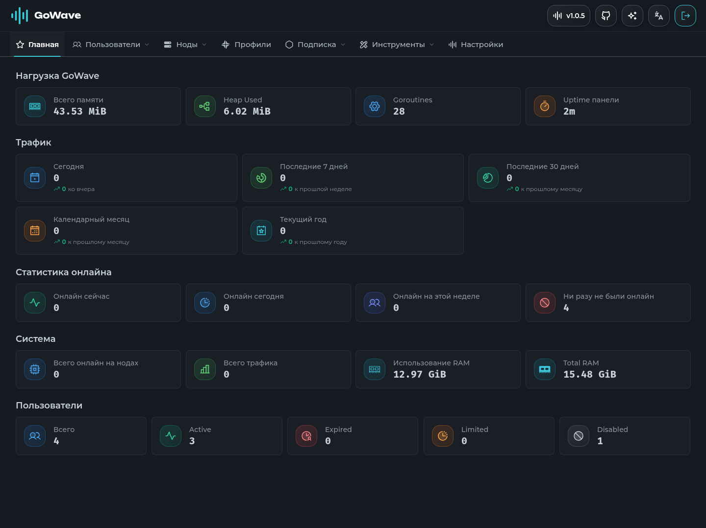
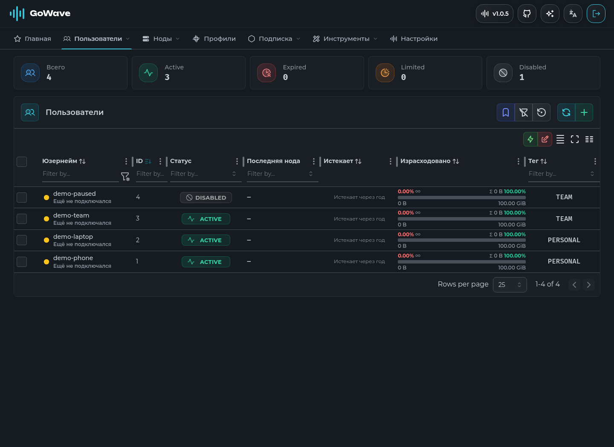

# GoWave

панель управления Xray-узлами, пользователями и подписками. сервер написан на Go, интерфейс на React. данные хранятся в SQLite или PostgreSQL.

[исходники](https://github.com/sorried/gowave-light/tree/main) · [документация](https://sorried.github.io/gowave-light-docs/) · [релизы](https://github.com/sorried/gowave-light/releases)

## интерфейс

снимки локальной панели с демонстрационными пользователями.





## установка

нужны Linux на amd64 или arm64, доступ root и домен для HTTPS. установщик предлагает SQLite с systemd или PostgreSQL в Docker, настраивает Caddy либо Nginx. можно использовать свой обратный прокси.

установщик скачивает готовые файлы из релизов `sorried/gowave-light`. если релиз ещё не опубликован, используйте [сборку из исходников](#разработка). адрес образа для релизных workflow: `ghcr.io/sorried/gowave-light`.

```sh
curl -fsSLo /tmp/gowave-install.sh https://raw.githubusercontent.com/sorried/gowave-light/main/install.sh
sudo bash /tmp/gowave-install.sh
```

панель по умолчанию слушает `127.0.0.1:3000`. после установки откройте домен панели и создайте аккаунт администратора. API и публичные подписки находятся под `/api`; `PANEL_BASE_PATH` меняет только путь панели и её статических файлов.

для обновления существующей установки:

```sh
sudo bash /tmp/gowave-install.sh --update
```

вариант с Docker описан в [документации](https://sorried.github.io/gowave-light-docs/install/docker/). готовая конфигурация находится в [docker-compose.yml](docker-compose.yml), пример переменных в [.env.docker.example](.env.docker.example). задайте собственные `APP_SECRET` и `POSTGRES_PASSWORD`, затем запустите `docker compose up -d`.

для сборки из локального checkout вместо скачивания образа:

```sh
docker compose -f docker-compose.yml -f docker-compose.build.yml up -d --build
```

## небольшой сервер

для сервера с 1 vCPU, 2 ГБ RAM и 30 ГБ диска начните с готового релиза и SQLite. сборку frontend и Go-бинарника выполняйте отдельно. веб-интерфейс поставляется рядом с бинарником; Node.js и Bun нужны для разработки и сборки.

дополнительные настройки в `.env`:

| параметр | действие |
| --- | --- |
| `METRICS_ENABLED=false` | закрывает отдельный HTTP-порт метрик; сбор внутренних метрик продолжается |
| `DB_MAX_CONNECTIONS=5` | ограничивает пул PostgreSQL; к SQLite не применяется |
| `SERVICE_DISABLE_USER_USAGE_RECORDS=true` | отключает историю трафика по пользователям и узлам; общие счётчики продолжают обновляться |
| `SERVICE_DISABLE_SRH_RECORDS=true` | отключает запись истории запросов подписок |

история и резервные копии занимают место по мере работы. необходимые ресурсы зависят от числа пользователей, узлов и запросов. условия локальных замеров, ограничения проверки и результаты оптимизаций приведены в [отчёте](docs/performance.md).

## разработка

используются Go из [go.mod](backend-go/go.mod) и Bun 1.4.2. модули backend и frontend устанавливаются отдельно.

```sh
cd frontend
bun install --frozen-lockfile
bun run start:dev
```

в другом терминале задайте `APP_SECRET` длиной не менее 32 символов и запустите backend:

```sh
cd backend-go
APP_SECRET="$(openssl rand -hex 32)" go run ./cmd/server
```

Vite открывает порт `3333` и проксирует `/api` на `127.0.0.1:3000`. для этого режима оставьте `DOMAIN_OVERRIDE=0` в настройках frontend. backend по умолчанию создаёт `gowave.db` в рабочем каталоге.

производственная сборка:

```sh
cd frontend
bun run editor:download
bun run build
bun run editor:compress
cd ../backend-go
CGO_ENABLED=0 go build -trimpath -ldflags='-s -w' -o /tmp/gowave ./cmd/server
```

backend ищет интерфейс в `./frontend/dist`, `./dist`, `../frontend/dist`, `./static`, `/opt/gowave/frontend/dist` и `/opt/gowave/dist` в этом порядке. сохраняйте структуру файлов из архива frontend, включая сжатые ресурсы редактора.

## проверки

```sh
cd backend-go
go vet ./...
go test -race -count=1 ./...
gofmt -l .
cd ../frontend
bun run check
bun run typecheck
bun run test
bun run build
CHROMIUM_BIN=/path/to/chrome bun run test:browser
cd ..
bun scripts/check-branding.cjs
```

для PostgreSQL задайте `GOWAVE_TEST_POSTGRES` перед запуском Go-тестов. тесты создают отдельные схемы, поэтому используйте тестовую базу с правом создания и удаления схем.

совместимость API проверяется с `@remnawave/backend-contract` версии `3.4.15`: маршруты, схемы ответов и статусы HTTP. тесты подписок сравнивают клиентские форматы с сохранёнными эталонами. команды выгрузки контракта и проверки живых ответов находятся в [scripts](scripts).

## лицензия

[AGPL-3.0](LICENSE). атрибуция зависимостей и исходных компонентов сохранена в проекте.
