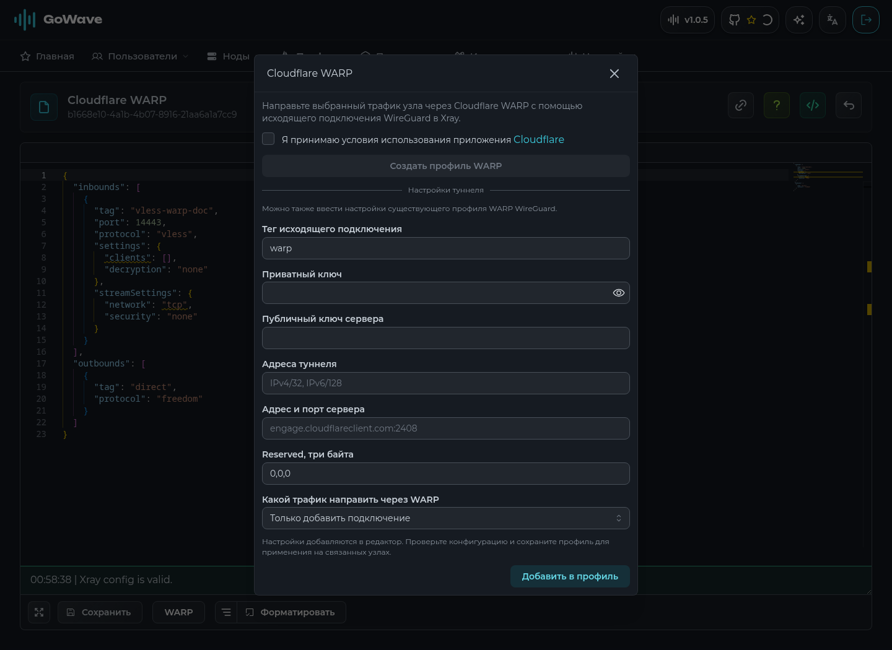

# Cloudflare WARP

WARP добавляется в профиль конфигурации как исходящее подключение WireGuard. туннель работает в Xray на узле. панель обращается к Cloudflare только при нажатии кнопки регистрации; новые фоновые сервисы не запускаются.

## подключение

1. откройте нужный профиль в разделе «профили» и нажмите `WARP` рядом с кнопкой сохранения.
2. для нового профиля WARP примите [условия Cloudflare](https://www.cloudflare.com/application/terms/) и нажмите «создать профиль WARP». приватный ключ создаётся в браузере, в Cloudflare отправляется публичный ключ.
3. вместо регистрации можно ввести настройки готового профиля WireGuard: приватный ключ, публичный ключ сервера, адреса туннеля, адрес сервера с портом и три байта `reserved`.
4. выберите трафик, добавьте настройки в редактор и дождитесь проверки Xray. затем сохраните профиль. существующий механизм синхронизации применит его на связанных узлах.

для разных узлов используйте отдельные профили и ключи WARP. общий профиль раздаёт одинаковые ключи всем связанным узлам.

## маршруты

| вариант | результат |
| --- | --- |
| только добавить подключение | в `outbounds` появляется WARP, правила маршрутизации сохраняются |
| выбранные домены | добавляется правило для введённых доменов; служебные правила API и метрик сохраняют приоритет |
| трафик, не совпавший с существующими правилами | правило `tcp,udp` добавляется в конец списка; предыдущие правила продолжают обрабатываться первыми |

домены вводятся по одному на строку или через запятую. поддерживаются селекторы Xray, например `domain:example.com`, `full:example.com` и `geosite:google`. для `geosite` на узле нужна соответствующая база геоданных.

существующий тег подключения не перезаписывается: выберите другой тег или отредактируйте старое подключение вручную. добавление можно отменить обычной командой undo в редакторе до сохранения.

в настройках используется `noKernelTun: true`, как в текущем генераторе WARP 3x-ui. Xray обрабатывает туннель в пользовательском пространстве. новые системные разрешения для панели не требуются. формат подключения описан в [документации Xray](https://xtls.github.io/config/outbounds/wireguard.html).

## регистрация и доступ

`POST /api/config-profiles/warp/register` принимает `publicKey` в стандартном base64 и `acceptTerms: true`. требуется JWT администратора; API-токены, включая токены со scope `*`, не допускаются. ответ содержит адреса туннеля, публичный ключ сервера, endpoint и reserved. токен устройства Cloudflare не возвращается и не сохраняется.

регистрация использует API Cloudflare, к которому обращается [3x-ui](https://github.com/MHSanaei/3x-ui/blob/main/internal/web/service/integration/warp.go). доступность этого API зависит от Cloudflare и сети панели. при отказе можно ввести готовые настройки вручную.

## что проверено

проверены генерация WireGuard-ключей, валидация настроек, порядок маршрутов, права доступа, обработка некорректных ответов и ошибок Cloudflare. браузерная проверка использует тестовый ответ регистрации. профиль сохранён через настоящий backend, конфигурация принята встроенным Xray WASM-валидатором.

реальный аккаунт Cloudflare при проверке не создавался; прохождение трафика через внешний узел WARP не проверено. после применения профиля проверьте нужный сайт через подключённого к узлу клиента. для проверки маршрута всего трафика можно открыть `https://www.cloudflare.com/cdn-cgi/trace`: значение `warp=on` показывает использование WARP. [проверка описана Cloudflare](https://developers.cloudflare.com/warp-client/get-started/linux/). при маршрутизации только отдельных доменов эта проверка должна также попадать в правило WARP.
