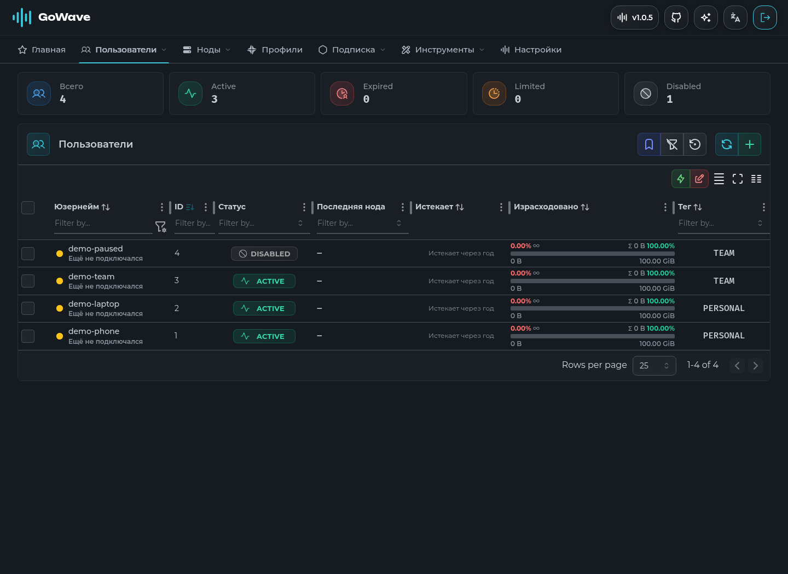

# интерфейс GoWave

React-приложение для [sorried/gowave-light](https://github.com/sorried/gowave-light/tree/main). используется Mantine, TypeScript и Vite. установка панели описана в [основном README](../README.md), атрибуция исходного интерфейса сохранена в [LICENCE](LICENCE).



## запуск

нужен Bun 1.4.2. зависимости закреплены в `package.json` и `bun.lock`.

```sh
bun install --frozen-lockfile
bun run start:dev
```

интерфейс доступен на порту `3333`, запросы `/api` проксируются на `127.0.0.1:3000`. для локального backend оставьте `DOMAIN_OVERRIDE=0`. адрес backend и принудительный выбор домена настраиваются в переменных `DOMAIN_BACKEND` и `DOMAIN_OVERRIDE` во время сборки.

## сборка

```sh
bun run editor:download
bun run build
bun run editor:compress
```

результат находится в `dist`. редактор и Xray-валидатор загружаются при открытии редактора в браузере. скрипт загрузки проверяет хеши ресурсов; сжатие оставляет WASM валидатора в виде `main.wasm.gz`. backend умеет отдавать этот файл браузерам с поддержкой gzip и без неё.

## проверки

```sh
bun run check
bun run typecheck
bun run test
bun run build
CHROMIUM_BIN=/path/to/chrome bun run test:browser
```

`build` запускает Vite и не заменяет проверку типов. браузерные тесты используют установленный Chrome или Chromium через протокол отладки, без дополнительной зависимости для автоматизации.

после изменения CSS-классов выполните `bun run css:types` и сохраните сгенерированные `*.module.d.css.ts` вместе с CSS. `typecheck` проверяет актуальность этих деклараций, приложение, тесты и конфигурацию Vite.

Biome проверяет форматирование, импорты и правила кода. безопасные исправления выполняет `bun run fix`. изменения зависимостей сохраняйте вместе с `bun.lock`.

локализации находятся в `public/locales`. после изменения английских ресурсов `bun run toc` обновляет типы переводов. `just` показывает дополнительные команды обслуживания; `just tag-release` создаёт тег и отправляет его в удалённый репозиторий, поэтому используйте эту команду только для публикации релиза.
